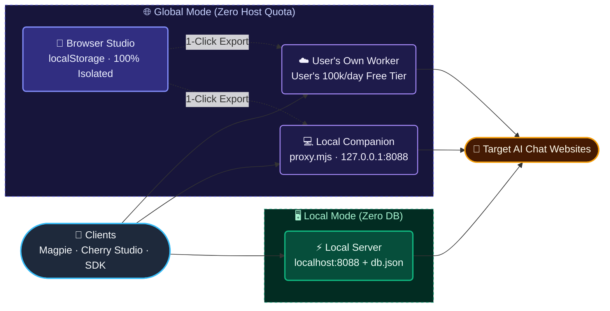

<div align="center">

# ⚡ Proxy Studio

**Connect any AI chat website to OpenAI-compatible clients — locally or globally with zero database & zero host quota.**

[](https://proxy-studio.pages.dev)
[](https://nodejs.org/)
[-blue?style=for-the-badge)](#)
[](#openai-compatible-gateway)

[🌐 Try Global Demo](https://proxy-studio.pages.dev) · [🚀 Quick Start](#-quick-start) · [🔌 Connect a Site](#-how-site-discovery-works) · [☁️ Zero-Quota Hosting](#-global-zero-quota-hosting) · [📡 API Reference](#-openai-compatible-gateway)

</div>

---

## ✨ Why Proxy Studio?

| Feature | Description |
| :--- | :--- |
| 🏠 **Local-First & Zero DB** | Everything (adapters, settings, last 200 logs) lives in `./data/db.json`. No Postgres, Docker, or migrations required. |
| 🌍 **Global Zero-Quota Mode** | Host publicly on **Cloudflare Pages** (unlimited static requests). Each user's data stays privately in their own browser `localStorage`. |
| 🔍 **3-Tier Site Discovery** | Automatically falls back from **Static Bundle Scan** → **Live Browser Capture** → **cURL / fetch Paste**. |
| 📦 **1-Click Gateway Export** | Export a personal **Cloudflare Worker** (`worker.js`) or zero-dependency **Local Companion** (`proxy.mjs`) in one click. |
| 🧠 **Smart Suffix Routing** | Append `-think`, `-search`, or `-think-search` to any supported model ID to toggle reasoning & web search without changing client settings. |

---

## 🗺️ Architecture


---

## 🚀 Quick Start

### Option 1: Use Online (Zero Install)

Open **[proxy-studio.pages.dev](https://proxy-studio.pages.dev)** directly in your browser. Capture any site, then click **Export Gateway** to deploy your own free Cloudflare Worker or download a zero-dependency local proxy.

### Option 2: Run Locally on macOS / Windows / Linux

Requires **Node.js 20.9+** and `npm`.

```bash
npm install
npm start

```

Open **[http://localhost:8088](http://localhost:8088)** in your browser.

* **macOS 1-Click**: Double-click `start-mac.command` to auto-install dependencies, start the server, and open the UI.
* **Custom Port**: Run `PORT=9000 npm start` (binds to `127.0.0.1` by default).
* **Rebuild**: The first `npm start` builds automatically; run `npm run build` after modifying source code.

> ⚠️ **Security Note:** Setting `HOST=0.0.0.0` exposes the unauthenticated management dashboard to your network. Keep it bound to `127.0.0.1` unless protected behind your own auth layer.

---

## 🔌 How Site Discovery Works

Proxy Studio uses a resilient **3-tier fallback pipeline** so minor site variations don't break your workflow:

1. **Tier 1 — Auto-Discover (Static Scan)**
Paste any AI chat URL. Proxy Studio fetches the HTML and public JS/CSS bundles, heuristically extracts candidate endpoints, models, and headers, and runs a safe live probe to verify connectivity.
2. **Tier 2 — Live Browser Capture (Automatic Fallback)**
If static discovery fails (auth-gated, Cloudflare-protected, or obfuscated sites), Proxy Studio launches a live capture session with a **Console snippet** and **draggable Bookmarklet**:
* Hooks `fetch`, `XMLHttpRequest`, `EventSource`, and **`WebSocket`** non-destructively.
* Auto-hooks same-origin `<iframe>`s and prints a bright warning if cross-origin `<iframe>`s are detected (guiding you to switch the DevTools `top` dropdown).
* Handles JSON, `text/plain`, `FormData`, `URLSearchParams`, `GET` params, and WS frames.
* **CSP Fallback**: If the target site blocks auto-POSTing to `localhost:8088`, captures are saved to `window.__proxyCapture.last` — simply run `copy(__proxyCapture.last)` in Console and paste into the **Manual Paste Fallback** box.


3. **Tier 3 — Paste cURL / fetch (For `HttpOnly` Cookies)**
For sites returning `401`/`403` due to `HttpOnly` session cookies, right-click the chat request in DevTools Network → **Copy as cURL** (or **Copy as fetch**) and paste it in. Pasted text is strictly parsed, never executed.

> 💡 **Pre-configured Demo:** Includes a bundled **RusherAI** adapter (`https://allaitools-generate.freemodels.workers.dev/api/chat`) so you can test streaming immediately out of the box. *(Upstream availability and model labels are controlled by the third-party site.)*

---

## ☁️ Global Zero-Quota Hosting

Host your own public instance on **Cloudflare Pages** with **0 shared database** and **0 host Workers quota consumed** (see `DEPLOY_GLOBAL.md`):

```bash
npm run build:pages
npx wrangler pages deploy out --project-name=proxy-studio

```

Every visitor gets:

* **Private Browser Storage**: Adapters, headers, and Playground history never leave their browser.
* **Personal Cloudflare Worker Export**: Ready-to-deploy `worker.js` + `wrangler.toml` running on *their own* free 100,000 req/day quota.
* **Local Companion Export**: Zero-dependency `proxy.mjs` + `start-mac.command` + `start-windows.bat` (no `npm install` needed).

---

## 📡 OpenAI-Compatible Gateway

Point **Magpie**, **Cherry Studio**, or any **OpenAI SDK** to `http://localhost:8088/v1` (or your exported Worker URL).

### Endpoints

| Method | Endpoint | Description |
| --- | --- | --- |
| `GET` | `/v1/models` | Lists all enabled models (`adapter-id/model-id`) including suffix variants. |
| `POST` | `/v1/chat/completions` | Chat completions supporting both JSON and SSE streaming (`stream: true`). |
| `GET` | `/proxy/:adapterId/v1/models` | Isolated model list for a single adapter (unprefixed IDs). |
| `POST` | `/proxy/:adapterId/v1/chat/completions` | Isolated chat endpoint for a single adapter. |

### Model Suffix Routing

| Suffix | Thinking / Reasoning | Web / Deep Search |
| --- | --- | --- |
| *(none)* | Off | Off |
| `-think` | ✅ On | Off |
| `-search` | Off | ✅ On |
| `-think-search` | ✅ On | ✅ On |

#### cURL

```bash
curl http://localhost:8088/v1/chat/completions \
  -H 'Content-Type: application/json' \
  -d '{
    "model": "rusherai/gpt-6-astra",
    "messages": [{"role": "user", "content": "Hello!"}],
    "stream": true
  }'

```

#### Python (OpenAI SDK)

```python
from openai import OpenAI

client = OpenAI(base_url="http://localhost:8088/v1", api_key="not-needed")
reply = client.chat.completions.create(
    model="rusherai/gpt-6-astra",
    messages=[{"role": "user", "content": "Hello!"}],
)
print(reply.choices[0].message.content)

```

*Optional Auth:* Configure a gateway API key under **Settings** or via the `STUDIO_API_KEY` environment variable (env var takes precedence), then pass `Authorization: Bearer YOUR_KEY` or `X-API-Key`.

---

## 🔒 Security & Data Notes

* **Local Storage**: Imported headers, cookies, request templates, and saved keys are stored **unencrypted** in `data/db.json`. Do not commit or share this file. Header values are masked in the dashboard API, and prompts/responses are excluded from activity logs.
* **Network & SSRF Protection**: Private, loopback, and link-local discovery targets are blocked by default. For trusted local test servers only, start with `STUDIO_ALLOW_PRIVATE_TARGETS=1 npm start`.
* **CORS**: Enabled on gateway endpoints for browser clients; set a gateway key if you do not trust other websites running on your machine.
* **Limitations**: Discovery is heuristic and cannot bypass authentication, solve CAPTCHAs, or execute obfuscated code. Only connect sites and credentials you are authorized to use.
* **Backup**: If `data/db.json` is deleted, it regenerates with the bundled adapter on the next request. Do not edit it while the server is running.
